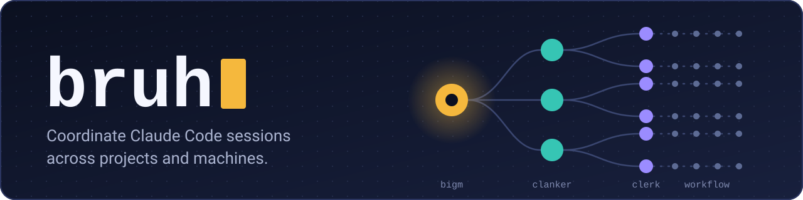

<p align="center">
  
</p>

<p align="center">
  <a href="https://github.com/oter/bruh/actions/workflows/ci.yml"></a>
  <a href="https://github.com/oter/bruh/releases/latest"></a>
  <a href="LICENSE"></a>
  <a href="https://scorecard.dev/viewer/?uri=github.com/oter/bruh"></a>
</p>

# bruh

bruh is a Claude Code plugin with skills for code changes and reviews: the skill `/bruh:implement`, five workflows, and the house rules for review.

The roles bigm, clanker, and clerk are in a separate plugin, `coordinator@oter` (see [oter/coordinator](https://github.com/oter/coordinator)). The skill and the workflows run without it. When the coordinator is installed, its clerks run the workflows of bruh.

## Implement and review

The skill `/bruh:implement` is the procedure for each code change and each review. The orchestrating session does not edit code. An implementer agent writes the change from a brief, and a separate reviewer agent checks it with the review guides, in a fix loop. For a settled spec with many changes, the skill uses four workflows:

| Workflow | What it does |
|---|---|
| `/bruh:tickets` | Breaks a settled spec into function-sized TDD tickets and execution waves, reviewed in a fix loop |
| `/bruh:implement-tickets` | Implements the tickets wave by wave, in parallel lanes (`scripts/lane.sh`), with a reviewer for each ticket and a whole-branch gate |
| `/bruh:review-and-fix` | Reviews an own change with several lenses and the gates, refutes each finding, and fixes the confirmed findings one area at a time |
| `/bruh:review-only` | Reviews and refutes a pull request of another author, and changes nothing |

The fifth workflow, `/bruh:deliver`, delivers one task: plan, implement, review, refute, fix, and review again. Its review step runs four checks in parallel: an adversarial reviewer, an invariant checker, a simplicity reviewer, and the gates. One refuter checks each finding. The simplicity reviewer finds code that is more complex than the task needs and names a concrete simpler replacement for each finding. What the task asks for is not a finding. `/bruh:review-and-fix` and `/bruh:review-only` can take a `simplicity` lens too: see `plugins/bruh/skills/implement/references/example-args.md` and `simplicity.md` next to it.

When `args.house_rules` is missing or empty, `/bruh:deliver`, `/bruh:review-and-fix`, and `/bruh:review-only` use the house rules of `plugins/bruh/defaults/house-rules.md`.

No workflow posts on a pull request. A workflow returns its findings. After your yes, they are posted with plain `gh pr review --comment --body-file <file>` on GitHub or `glab mr note create` on GitLab. For a self-hosted server, the `--repo` value names the host. Each post ends with the marker line `<!-- bruh:<role key> -->`, or `<!-- bruh:owner -->` in your own session.

In your own session, you are the orchestrator: start with `/bruh:implement` and answer the questions of the session. When a workflow has a question, the run returns `status: question` with the id `chat:<step>`. Answer it in chat, and the session relaunches the run with your answer. The session writes the result of a workflow to `.bruh/results/<name>.json` in the root of the run. Add `.bruh/` to the `.gitignore` of the project.

With the coordinator, a clerk runs the skill. The workflow agents then ask through the question tools of the coordinator, and the clerk saves the result with its tool `result_save`.

## Install

```bash
claude plugin marketplace add oter/bruh
claude plugin install bruh@oter
```

Install at user scope, so that all your projects get the plugin.

For the roles, install the coordinator plugin `coordinator@oter` too. Its install steps are in [oter/coordinator](https://github.com/oter/coordinator).

### Upgrade from 0.12.x

bruh 0.12.x holds the roles, and bruh 0.13.0 does not. Do not run bruh 0.12.x and the coordinator at the same time. Let the running tasks finish first. Then update bruh:

```bash
claude plugin marketplace update oter
```

```bash
claude plugin update bruh@oter
```

Then install the coordinator as its README says.

## Requirements

| Requirement | Why |
|---|---|
| Claude Code with the `Workflow` tool | The five workflows |
| `git` | Worktrees, branches, and the pinned base SHA |
| `rsync` | The lanes of `/bruh:implement-tickets` (`scripts/lane.sh`) |
| `gh` | GitHub posts (`gh pr review`) |
| `glab` | GitLab posts (`glab mr note create`) |
| macOS or Linux | Native Windows is not supported |

## Documentation

- [Specification](docs/spec.md): what the skill and the workflows do, and the tag of each decision.
- [Plugin split](docs/design/plugin-split.md): why bruh and the coordinator are two plugins.
- [Changelog](CHANGELOG.md), [contributing](CONTRIBUTING.md), and [security policy](SECURITY.md).

## License

[Apache-2.0](LICENSE).
